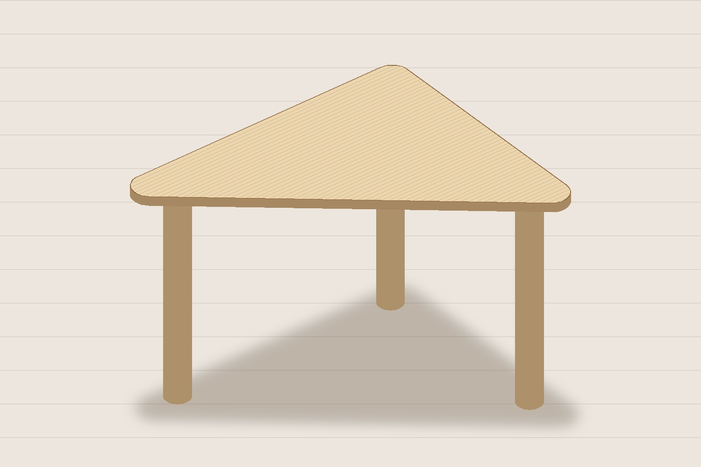
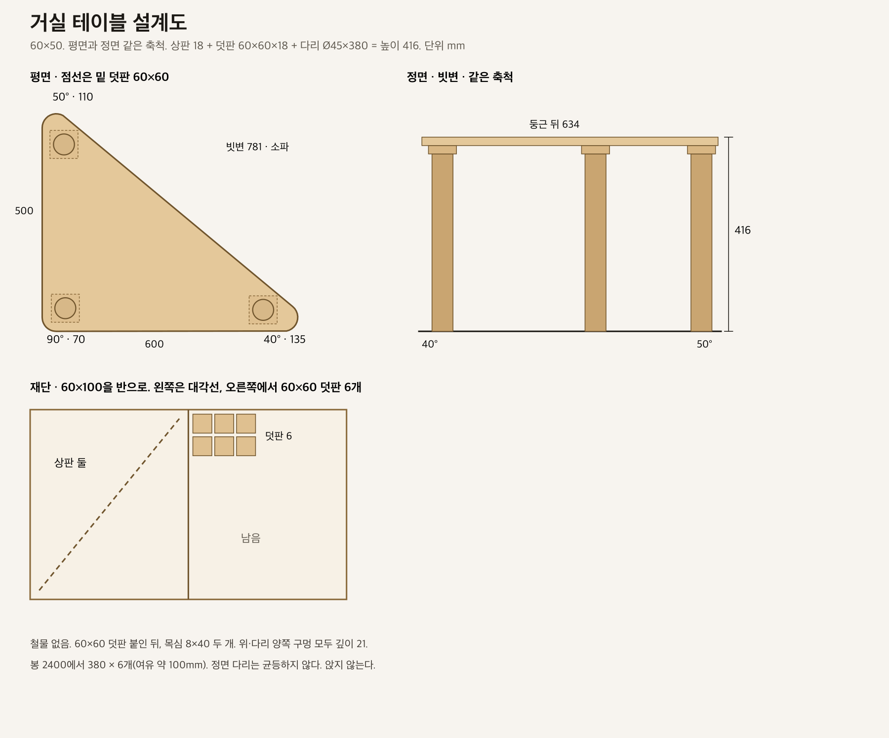
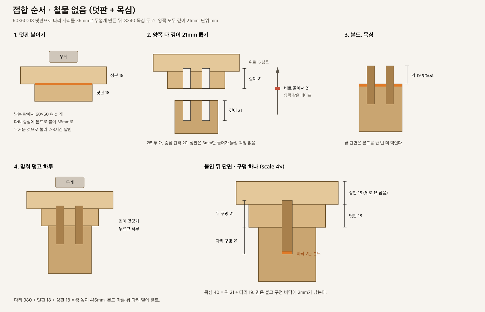

# 거실 테이블 두 개

화분대가 아니다. 상판은 **60×50cm** 직각삼각형 두 개다. 철물은 쓰지 않는다.

파는 판은 60×100cm다. 길이 한가운데를 잘라 60×50 두 장을 만든다. 한 장은 대각선으로 잘라 상판 둘로 쓰고, 나머지 반 장에서 **60×60mm 덧판 여섯 개**를 잘라 다리 자리에 붙인다.

좋은 면을 위로 둔다. 두 상판은 거울이 아니다. 한 장을 180° 돌리면 같은 모양이다.





구입 목록은 [구입품목.md](구입품목.md).

---

## 1. 치수 (하나)

판을 재고 적는다. 아래는 60×50이 정확히 600×500mm일 때의 약수다.

```
        50°
       ╱──────── 빗변 약 781 · 소파 쪽
     ╱
   ╱  500
 ╱________
 직각 90°      600      40° 뾰족
```

| | |
| --- | --- |
| 직각변 | **600 × 500** |
| 빗변 | **약 781**. 소파 쪽. 모서리를 둥글리면 그 변은 약 634 |
| 빗변에서 직각까지 | **약 384** |
| 상판 + 덧판 | 상판 18mm + 다리 자리 덧판 **60×60×18mm** (합 36mm) |
| 다리 | Ø45 × **380** × 3 |
| 윗면 높이 | **416** (다리 380 + 덧판 18 + 상판 18) |

깊이가 384라 높이 416보다 얕다. 앉거나 빗변에 기대지 않는다.

다리 중심은 꼭짓점에서 **각의 이등분선**을 따라 잰다. 둥글리기 전에 표시한다.

| 꼭짓점 | 각도 | 다리 중심 |
| --- | --- | --- |
| 직각 | 90° | **70mm** |
| 500 변과 빗변 | 약 50° | **110mm** |
| 600 변과 빗변 | 약 40° | **135mm** |

뾰족한 쪽은 600 변과 빗변이 만나는 곳이다. 135mm는 거기에 둔다. 60×60 덧판은 다리 중심에 맞춰 붙이면 어느 각도에서도 상판 변 밖으로 나오지 않는다.

표시한 뒤에 세 꼭짓점을 반지름 30mm로 둥글린다.

---

## 2. 재단

```
60cm
┌──────────┬──────────┐
│    ╱     │ 60×60 ×6 │
│  상판 둘  │  (덧판)   │
│          │   남음    │
└──────────┴──────────┘
    50cm       50cm
        100cm 판
```

1. 폭과 길이를 잰다. 길이 한가운데, 약 50cm에 금을 긋고 자른다
2. 한 장의 좋은 면을 위로 두고, 왼쪽 아래 → 오른쪽 위로 대각선을 곧은 자에 대고 자른다
3. 나머지 반 장에서 **60×60mm 덧판 6개**를 자른다
4. 상판 밑에 다리 중심 세 점을 표시한 다음, 꼭짓점을 반지름 30mm로 둥글린다
5. 자른 면을 P120, 이어서 P180. 공장에서 갈린 넓은 면은 P180만

봉 2400mm에서 **380mm × 6개**를 자른다. 톱날 다섯 번을 포함해도 약 2295mm라 100mm 넘게 여유가 남는다. 밑은 살짝 모따기, 위는 평평하게.

---

## 3. 조립 (철물 없음 · 덧판 + 목심)

ㄱ자 철물이나 고정판은 쓰지 않는다. 남는 판으로 만든 **60×60×18mm 덧판**을 상판 밑에 본드로 먼저 붙여 다리 자리를 **36mm**로 두껍게 만든 뒤, **8×40 목심 두 개**로 다리를 잇는다.



상판+덧판 쪽과 다리 쪽 **둘 다 깊이 21mm**로 뚫는다. 드릴 테이프를 바꿀 필요가 없고, 상판 윗면까지 15mm가 남아 뚫릴 위험이 없다.

하나를 끝내고 한 번 더 한다.

1. 상판 밑의 다리 중심에 **60×60 덧판**을 맞추어 본드로 붙인다. 무거운 것으로 눌러 최소 2–3시간(여유 있으면 하루) 말린다
2. 드릴 비트 **끝**에서 **21mm**에 테이프를 감는다
3. 덧판 가운데(다리 자리)에 Ø8 구멍 두 개. 중심 간격 20mm, 깊이 **21mm**. 덧판 18mm를 지나 상판으로 3mm 들어간다
4. 다리 윗면 가운데에도 똑같이 Ø8 구멍 두 개. 중심 간격 20mm, 깊이 **21mm**
5. 목심 8×40과 다리 끝 단면에 본드를 바른다. 끝 단면은 본드를 한 번 더 먹인다
6. 목심을 다리에 꽂고 덧판 구멍에 맞춘 뒤, 무거운 것으로 눌러 하루 말린다. 합 42mm 구멍에 40mm 목심이 들어가 바닥에 2mm 본드 자리가 남는다
7. 뒤집어서 흔들림을 본다. 오일 또는 왁스. 다리 밑 펠트
8. 빗변이 소파 쪽. 오일 묻은 천은 물에 적셔 뚜껑 있는 통에 넣는다

---

## 4. 확정 · 남은 것

- [x] 60×100을 반으로 잘라 60×50 상판 둘 + 남는 반 장에서 60×60 덧판 6개
- [x] 철물 없음. 덧판(36mm) + 8×40 자작 목심 2개. 구멍은 양쪽 모두 깊이 21mm
- [x] 다리 위치 70 / 110 / 135. 봉 하나에서 380mm × 6개, 총 높이 416mm
- [ ] 매장 판의 실제 폭과 길이
- [ ] 하나는 거실, 하나는 응접실
